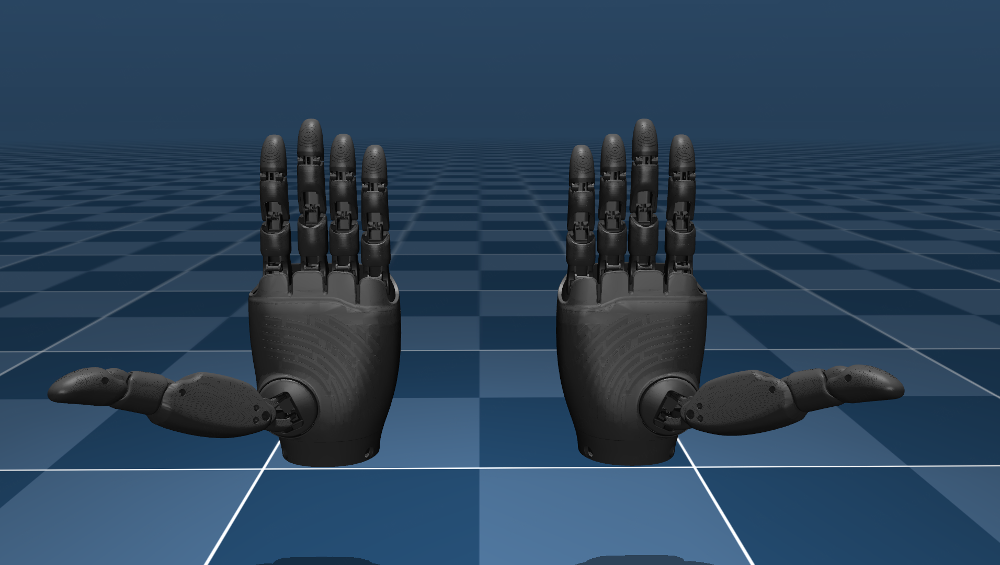

# OmniHandPro ROS 2 Package

This is a ROS 2 package for **OmniHandPro**. It includes the URDF files for both the left and right hands, along with visualization support in RViz. The recommended ROS 2 distribution for using this package is **Humble**.

## Installation

### 1. Clone the Repository
Create a new `src` directory, navigate into it, and clone the repository:

```bash
mkdir -p ~/omnihand_pro_ws/src
cd ~/omnihand_pro_ws/src
git clone <repository_url>
cd ..
```

### 2. Build the Package
Build the workspace using:

```bash
colcon build
```

### 3. Source the Setup File
Before using the package, source the workspace setup file:

```bash
source install/setup.bash
```

## Generate OmniHandPro URDF File

To generate the URDF description from the Xacro files:

```bash
cd ~/omnihand_pro_ws/src/omnihand_pro_description/assets/urdf/xacro
xacro omnihand_pro_right.xacro > omnihand_pro_right.urdf
xacro omnihand_pro_left.xacro > omnihand_pro_left.urdf
```

## Visualization in RViz

### Right Hand
```bash
ros2 launch omnihand_pro_description omnihand_pro_description_launch.py
```

### Left Hand
```bash
ros2 launch omnihand_pro_description omnihand_pro_description_launch.py hand_type:=left
```

> **Note on Joint Coupling Accuracy**\
> URDF only supports **linear coupling** between passive and active
> joints.\
> However, OmniHandPro's mechanical structure uses **nonlinear
> coupling** for most passive joints, making it impossible for the URDF
> model to fully match the real hardware behavior.\
> If you need to simulate the **true nonlinear coupling**, please refer
> to: 
> - The **MuJoCo MJCF model**, which contains accurate nonlinear mappings
> - The **OmniHandPro SDK**, which provides real coupling functions

------------------------------------------------------------------------

## MuJoCo MJCF Files

This package also provides **MuJoCo MJCF models** for simulating OmniHandPro in physics-based environments.  
The MJCF files are compatible with **MuJoCo 3.1.0 and later**.

Model files are located at:

```
omnihand_pro_description/assets/MJCF/
```

This directory includes:

- `scene.xml` – A complete scene file for quick preview  
- `omnihand_pro_left.xml` – Left-hand model  
- `omnihand_pro_right.xml` – Right-hand model  
- `meshes/` – STL mesh assets used by MJCF  

### Quick Preview

To quickly preview the OmniHandPro model:

1. Open MuJoCo’s `simulate` viewer  
2. Drag and drop `assets/MJCF/scene.xml` into the window  
3. The OmniHandPro model will automatically load and display

Example:



---

# OmniHandPro ROS 2 软件包

这是一个用于 **OmniHandPro** 的 ROS 2 软件包，包含左右手的 URDF 模型文件，并支持在 RViz 中可视化显示。推荐使用的 ROS 2 版本为 **Humble**。

## 安装指南

### 1. 克隆仓库

创建工作空间并克隆仓库：

```bash
mkdir -p ~/omnihand_pro_ws/src
cd ~/omnihand_pro_ws/src
git clone <repository_url>
cd ..
```

### 2. 编译工作空间

运行以下命令进行编译：

```bash
colcon build
```

### 3. 加载环境

在使用前，需要加载工作空间的环境配置：

```bash
source install/setup.bash
```

## 生成 OmniHandPro 的 URDF 文件

通过 Xacro 文件生成 URDF：

```bash
cd ~/omnihand_pro_ws/src/omnihand_pro_description/assets/urdf/xacro
xacro omnihand_pro_right.xacro > omnihand_pro_right.urdf
xacro omnihand_pro_left.xacro > omnihand_pro_left.urdf
```

## RViz 可视化

### 显示右手模型
```bash
ros2 launch omnihand_pro_description omnihand_pro_description_launch.py
```

### 显示左手模型
```bash
ros2 launch omnihand_pro_description omnihand_pro_description_launch.py hand_type:=left
```

# OmniHandPro ROS 2 软件包

这是用于 **OmniHandPro** 的 ROS 2 软件包，包含左右手 URDF 模型并支持在
RViz 中可视化。推荐 ROS 2 版本：**Humble**。

> **关于关节耦合精度的说明**\
> URDF 仅支持 **线性耦合**，而 OmniHandPro
> 的大部分被动关节与主动关节之间是 **非线性耦合**。\
> 因此，URDF 模型无法完全复现真实机械手的耦合行为。\
> 若需要模拟真实耦合关系，请参考：
> - **MuJoCo 的 MJCF 模型**（已包含真实非线性映射）
> - **OmniHandPro SDK**（计算真实耦合关系）

------------------------------------------------------------------------

## MuJoCo MJCF 文件

本包也提供 **MuJoCo MJCF 模型**，可用于在物理仿真环境中模拟 OmniHandPro。  
MJCF 文件兼容 **MuJoCo 3.1.0 及以上版本**。

模型路径：

```
omnihand_pro_description/assets/MJCF/
```

包含以下内容：

- `scene.xml` – 完整场景文件，可快速预览  
- `omnihand_pro_left.xml` – 左手 MJCF 模型  
- `omnihand_pro_right.xml` – 右手 MJCF 模型  
- `meshes/` – 对应的 STL 网格文件  

### 快速预览方式

1. 打开 MuJoCo 自带的 `simulate` 查看器  
2. 将 `assets/MJCF/scene.xml` 拖入窗口  
3. 模型会自动加载并显示  

示例：

